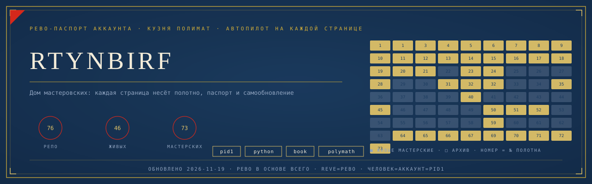
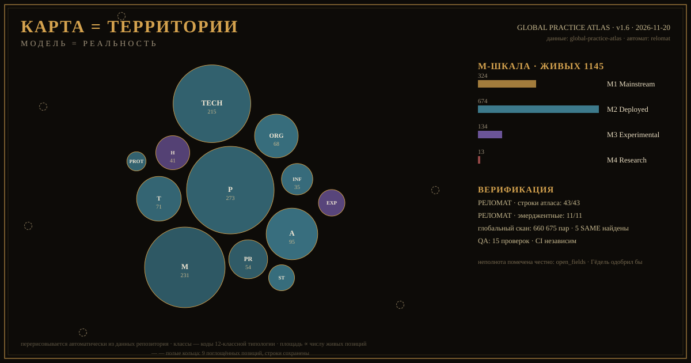
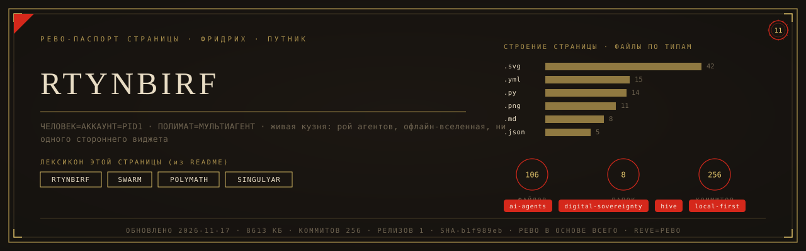

  

# rtynbirf · POLYMATH-UNIVERSUM

> Автономные системы, генеративные среды и офлайн-суверенитет. Человек остаётся источником цели и решения; система — расширяемой средой действия, которая меряет себя и чинит себя сама.

**Полимат-Универсум** — связанная мастерская программных, исследовательских и медиа-проектов: автономные агенты, локальные инструменты, офлайн-приложения, архитектуры взаимодействия и средства проверки технических утверждений.

English: *An interconnected lab for autonomous systems, generative media, and offline-first software — a self-measuring, self-repairing house of living documentation.*

[Открыть витрину](https://rtynbirf.github.io/) · [Все репозитории](https://github.com/rtynbirf?tab=repositories) · [Документация профиля](docs/profile-frontpage/00_INDEX.md)

## С чего начать

| Если вы хотите… | Начните здесь |
|---|---|
| Понять архитектуру автономной среды | [Polymath OS](https://github.com/rtynbirf/polymath-os) |
| Открыть офлайн-медиа-среду | [СИНГУЛЯР](https://github.com/rtynbirf/singulyar) · [витрина](https://rtynbirf.github.io/singulyar/) |
| Изучить взаимодействие автономных компонентов | [cell-swarm](https://github.com/rtynbirf/cell-swarm) · [runtime-protocol](https://github.com/rtynbirf/runtime-protocol) |
| Работать с атласами практик и отношений | [global-practice-atlas](https://github.com/rtynbirf/global-practice-atlas) · [relomat](https://github.com/rtynbirf/relomat) |
| Увидеть дом как организм: рой, страж, свидетели | [Живой слой ниже](#живой-слой-дома--свидетельства-не-декларации) · [ТРЕБОВАНИЯ-ДЛЯ-АГЕНТОВ](ТРЕБОВАНИЯ-ДЛЯ-АГЕНТОВ.md) |
| Найти другие проекты | [Полный каталог](https://github.com/rtynbirf?tab=repositories) |

## Основные направления

**Автономные системы и вычислительная среда** — локальные инструменты, системная архитектура, проверяемая автономность. Точка входа: [Polymath OS](https://github.com/rtynbirf/polymath-os).

**Офлайн-медиа и пользовательские среды** — офлайн-доступные медиа-инструменты и интерфейсы. Точка входа: [СИНГУЛЯР](https://github.com/rtynbirf/singulyar).

**Рой и взаимодействие компонентов** — эксперименты с автономными узлами, кооперацией и протоколами: [cell-swarm](https://github.com/rtynbirf/cell-swarm), [runtime-protocol](https://github.com/rtynbirf/runtime-protocol).

**Атласы, знания и проверка утверждений** — систематизация практик, отношений, источников и свидетельств: [global-practice-atlas](https://github.com/rtynbirf/global-practice-atlas), [relomat](https://github.com/rtynbirf/relomat), [voice-atlas-llm](https://github.com/rtynbirf/voice-atlas-llm).

## Живой слой дома · свидетельства, не декларации

Ниже — не украшения, а исполнительная система доказательств. Боты дома перезаписывают
каждый блок из живого GitHub API: каждое число несёт штамп времени и источник; бейджи
читают committed JSON и «не могут соврать»; при недоступности источника видна честная
метка STALE/UNKNOWN, а не ручная подстановка. Правила дома (23–28) требуют для каждого
существенного утверждения цепочку «клейм → свидетельство → метод → область» —
политика и её исполнители описаны в [12_LIVING-LAYER.md](docs/profile-frontpage/12_LIVING-LAYER.md).

### СЕРДЦЕ ДОМА · ФАКТУМ — автомат, который делает факты

Бьётся каждые 6 часов (ФСМ `IDLE → RECON → IGNITE → MEASURE → RECORD`), измеряет три мира
(SKI / BCI / CHEM) и кладёт факты в соты append-only с sha256-цепочкой. ЭКГ дважды в час
меряет пульс, пишет свидетеля при смене статуса и реанимирует крон при тихой смерти (правило 26).

соты: <a href="https://github.com/rtynbirf/factum/blob/main/JOURNAL.md"><code>JOURNAL.md</code></a> ·
ЭКГ: <a href="https://github.com/rtynbirf/factum/blob/main/PULSE_LOG.md"><code>PULSE_LOG.md</code></a> ·
бейдж рендерится из committed <code>pulse.json</code> — бейдж не может соврать ·
генезис: <a href="https://github.com/rtynbirf/factum/blob/main/GENESIS.md"><code>GENESIS.md</code></a>

<!--ФОРЖ:АККАУНТ:НАЧАЛО-->

  

| РЕПО | ЖИВЫХ | МАСТЕРСКИХ | ОБНОВЛЕНО |
|---:|---:|---:|---|
| 81 | 80 | 73 | 2026-11-23 |
<!--ФОРЖ:АККАУНТ:КОНЕЦ-->

<!--НОО:ПУЛЬТ:НАЧАЛО-->

  
<b>◇ НООСЕТКА · ПУЛЬТ МИРОВ (С190)</b> — состояние каждого мира <i>вымеряется</i>, не декларируется:
  <code>GHOST → WIRE → LIVE → READY</code>, отказ → <code>DEGRADED</code> с причиной, архив → <code>SEALED</code>.
  Бейдж-виджет (автопромер каждые 6 ч): <a href="https://github.com/rtynbirf/noosetka"><b>noosetka</b></a> ·
  живой пульт в реальном времени: <a href="https://rtynbirf.github.io/noosetka/"><b>rtynbirf.github.io/noosetka</b></a> ·
  карта: <a href="https://rtynbirf.github.io/singulyar/%D0%9D%D0%9E%D0%9E%D0%A1%D0%95%D0%A2%D0%9A%D0%90.html"><b>НООСЕТКА.html</b></a>
   

  
бейдж читает committed <code>noo/badge.json</code> — бейдж не может соврать · репо без манифеста пульт видит как <code>GHOST</code> ·
  реестр миров: <a href="https://github.com/rtynbirf/singulyar/blob/rumu/noo/миры.json"><code>noo/миры.json</code></a> ·
  брайль-строка дома — канон <code>latin-g1</code> · REVE: layout → render · факт = байты

<!--НОО:ПУЛЬТ:КОНЕЦ-->

<!--АТЛАС:КАРТА:НАЧАЛО-->

  
  
КАРТА=ТЕРРИТОРИИ · МОДЕЛЬ=РЕАЛЬНОСТЬ — <a href="https://github.com/rtynbirf/global-practice-atlas">global-practice-atlas</a> · <a href="https://github.com/rtynbirf/relomat">relomat</a> · SVG перерисовывается на автомате из данных атласа

<!--АТЛАС:КАРТА:КОНЕЦ-->

### Витрины, которые рисует сам дом

  

  

  

<!--КАРТЫ:НАЧАЛО-->

  
<b>КАРТЫ НА СТОЛ · три захода (20.11.2026)</b> — отчёты в корне: <code>КАРТЫ-НА-СТОЛ/</code> ·
  заход 1: дом против мировых практик (7 источников) · дубль два: антигаллюцинация, 14 клеймов
  живыми уликами (7 / 5 / 2) + эмерджентный синтез · заход 3: механизм — правила 23–27 в закон,
  СТРАЖ СПЯЩИХ (приказ ≠ болезнь: 216 приказов пересчитаны, 0 болезней, kick тихой смерти —
  РЁВО-АВТОМАТ), ТРЕБОВАНИЯ-ДЛЯ-АГЕНТОВ.md. Счёт: 5,4 → 5,8 · закон: AGENTS.md 1–27 · REVE=РЕВО

<!--КАРТЫ:КОНЕЦ-->

<!--INV:АВТОМАТ:НАЧАЛО-->

  
  
🧬 КОНЕЧНЫЙ АВТОМАТ: <a href="https://github.com/rtynbirf/inv-automat">rtynbirf/inv-automat</a> — таблица переходов <code>IDLE→BOOT→INVENTORY→CLAIMS→VERIFY→LEDGER→REPORT→PUBLISH→DONE</code> · 📄 живой отчёт: <a href="https://rtynbirf.github.io/inv-automat/">Pages</a> · 📜 <a href="https://github.com/rtynbirf/inv-automat/blob/main/automat/ledger/runs.jsonl">ledger переходов</a> (append-only) · свидетель в каждой живой клетке — SVG перерисовывается автоматом из живого инвентаря, ни одной цифры из README

<!--INV:АВТОМАТ:КОНЕЦ-->

<!--ФОРЖ:МУЗА:НАЧАЛО-->

  
   
  

<!--ФОРЖ:МУЗА:КОНЕЦ-->

<!--ФОРЖ:ПАСПОРТ:НАЧАЛО-->

  

| ФАЙЛОВ | ПАПОК | КОММИТОВ | ОБНОВЛЕНО | РЕЛИЗОВ |
|---:|---:|---:|---|---:|
| 178 | 14 | 701 | 2026-11-27 | 0 |
<!--ФОРЖ:ПАСПОРТ:КОНЕЦ-->

<!--BEGIN_SWARM_SYNC-->
## 🛰 SWARM-SYNC · сверка со средой
> Автогенерация 2026-11-27 12:44 UTC · источник: живой GitHub API (public-флот: /users/rtynbirf/repos; языки — сумма байтов /repos/<repo>/languages, без истории git) · ни одного выдуманного числа · живой счёт роя для био — здесь, не в био

| Метрика | Значение |
|---|---|
| Репозиториев | **84** (84 публичных · 0 приватных) |
| Коммитов всего | **12813** |
| Последний push | 2026-11-27 |

**Языки по объёму кода:**
- `HTML` ██████████ 34.9 МБ
- `Python` ███████ 24.0 МБ
- `JavaScript` ███████ 22.8 МБ
- `Lean` ██ 6.9 МБ
- `PowerShell` █ 2.2 МБ

**Топ-5 репо по коммитам (видимая работа):**
- **rtynbirf** — 693 коммитов · Python
- **.github** — 517 коммитов · Python
- **cell-swarm** — 510 коммитов · Python
- **markitdown** — 503 коммитов · Python
- **H-PE11-PHOENIX** — 410 коммитов · PowerShell
<!--END_SWARM_SYNC-->

<!--ФОРЖ:КАНОН-СИНТЕЗ:НАЧАЛО-->
## 🧬 КАНОН × МИР · эмерджентный синтез (22.11.2026)

Дом прочитал мир и сверил законы (свежесть 22.11.2026): **agents.md** — открытый
стандарт инструкций агентам («over 60k open-source projects», под эгидой Linux
Foundation); **code.claude.com** — практики файлов памяти: «every line in it takes
a little of Claude's attention on *every* task», фильтр «Could it find this by
reading the code?», «the work is mostly removing lines»; исследование «Evaluating
AGENTS.md» (2026-02-12, по аннотации): раздутые context-файлы снижают успешность
агента и стоят +20% цены вывода.
Сходка подтвердила: append-only свидетель (нить Ариадны), fail-closed грамматики
(PeerManifest — четыре ключа), шрам-протокол, тесты канона — дом жил по этим
законам до того, как мир их сформулировал. Синтез — правила **29–37** закона дома:
РИТУАЛ ВХОДА · КАНОН = НЕПРОИЗВОДНОЕ · СВОД И ХВОСТ · ОБРАЗЕЦ СИЛЬНЕЕ КАПСА ·
ФОРМА, НЕ СПИСОК · ПРОГРЕССИВНОЕ РАСКРЫТИЕ · РЕЦЕДАЦИЯ ЯКОРЯ · ЧУЖОЙ ШРАМ — МОЙ
ФИКС · КАНОН-ПАТЧ. Свидетель захода — НИТЬ-АРИАДНЫ.jsonl (append-only хэш-цепочка);
патчи канона — диф-артефактами (правило 37).
<!--ФОРЖ:КАНОН-СИНТЕЗ:КОНЕЦ-->

<!--ФОРЖ:АВТОМАТ:НАЧАЛО-->

**РЁВО-АВТОМАТ ЦЕНТРАЛЬНЫЙ v2** · конечный автомат над флотом · ORNAMENTAL MYTHO-REALISM · ИЗДАНИЕ r19c

> ОПИСЬ ДИНАМИЧЕСКАЯ: ФЛОТ 85 → ЗДРАВИЕ:81 · ДРЕЙФ:3 · МУЗЕЙ:1 · зачислено сирот 2 (meta, nemoy-svidetel) · вылечено 0 · цикл: ПЕПЕЛ→ПРОБУЖДЕНИЕ→СВЕРКА→(зачисление/лечение)→ЗДРАВИЕ
> БАННЕР = ЛИЦО АККАУНТА: любое тело без лица зачисляется полным каноном автоматически. Доказательство работы: `automaton-state.json` и `fleet-desk.json`.

<!--ФОРЖ:АВТОМАТ:КОНЕЦ-->

<!--ФОРЖ:КАРТА:НАЧАЛО-->

### 🗺 ЖИВАЯ КАРТА РОЯ · переписывается автоматом при каждом обходе (данные API)

> Полотна лиц всех тел несут полосу ДАННЫХ API и перерисовываются, когда реальность ушла от запечатлённого (правило 25). Доказательства: `live-state.json`, `live-map.png`.

<!--ФОРЖ:КАРТА:КОНЕЦ-->

## Принципы

- **Человек задаёт цель; система подстраивается под человека.** Автоматизация не подменяет субъект принятия решений.
- **Офлайн — полноценный режим.** Сеть не должна становиться необъявленной обязательной зависимостью.
- **Утверждение не равно доказательству.** Реализация, эксперимент, предложение и неизвестное состояние различаются.
- **Состояние выводится из свидетельств.** Метрики имеют источник, время измерения и область действия; сила формулировки не превышает силу свидетельства.
- **Компоненты не объявляют себя целым.** Архитектура показывает границы и связи.

## Проверка и достоверность

Статус функции определяется в её репозитории, для конкретной версии и среды. Полная политика —
[06_EVIDENCE.md](docs/profile-frontpage/06_EVIDENCE.md): раздельные оси «реализация» (IMPLEMENTED /
EXPERIMENTAL / PROPOSED / PLANNED) и «проверка» (VERIFIED / NOT_TESTED / UNKNOWN / REFUTED),
уровни свидетельств E0–E4. В проектах с воспроизводимыми проверками используйте документированные
команды (например, `make verify` в [Polymath OS](https://github.com/rtynbirf/polymath-os)); результат
относится только к версии и среде, где команда действительно выполнена. Непроверенные свойства
не считаются подтверждёнными.

## Карта и текущее состояние

- [Витрина Полимат-Универсума](https://rtynbirf.github.io/)
- [Живая карта состояния](https://github.com/rtynbirf/rtynbirf/blob/main/live-state.json) ·
  [машинно-читаемый манифест](https://github.com/rtynbirf/rtynbirf/blob/main/noo-manifest.json) ·
  [стол флота](https://github.com/rtynbirf/rtynbirf/blob/main/fleet-desk.json)
- Дом чинит себя сам и ведёт честные шрамы: [KNOWN_ISSUES](KNOWN_ISSUES.md) ·
  [ledger свидетелей](INV_LEDGER.jsonl) · [ledger стража](СТРАЖ-СПЯЩИХ.jsonl) — динамические показатели поступают из одного
  генерируемого источника с временной меткой и методикой; при недоступности показывается
  последнее значение с меткой `STALE` либо `UNKNOWN`, но не ручная подстановка.

## Участие и обратная связь

Правила участия, лицензия, поддержка и безопасность различаются между репозиториями —
перед предложением изменений ознакомьтесь с документами конкретного проекта.

## Документация профиля

Аудит, техническое задание, политика доказательств и приёмка — в [`docs/profile-frontpage/`](docs/profile-frontpage/00_INDEX.md):

| Док | Содержание |
|---|---|
| [01 Аудит](docs/profile-frontpage/01_AUDIT.md) | внешний аудит: сильное, дефекты, сохранить |
| [03 ТЗ](docs/profile-frontpage/03_SPEC.md) | FR-01…12, нефункциональные требования |
| [06 Политика свидетельств](docs/profile-frontpage/06_EVIDENCE.md) | claim→evidence→method→scope, E0–E4 |
| [07 Модель данных](docs/profile-frontpage/07_DATA.md) | одна метрика — один источник, FRESH/STALE |
| [12 Живой слой](docs/profile-frontpage/12_LIVING-LAYER.md) | якорная система ФОРЖ: как дом доказывает сам себя |
| [Baseline README](docs/profile-frontpage/BASELINE-README-2026-11-25.md) | прежняя страница целиком (rollback) |

*О проекте: орнаментальный мифо-ритмический язык — часть визуальной идентичности; технические определения, статусы и результаты при этом остаются буквальными и проверяемыми. REVE=РЕВО.*