

  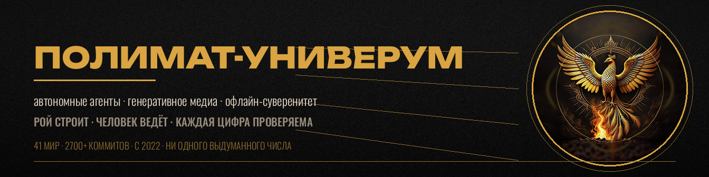

# rtynbirf · AUTONOMOUS SYSTEMS LAB

**Autonomous agents · Generative media · Offline sovereignty.**
«Строю то, что работает без интернета и без разрешений.»

  

  

  

  

  

  

## ЗАХОДИ С ПОТОЛКА

> Ты здесь случайно — и это лучший способ зайти. Три двери:

| 🎼 Послушать | 🤖 Изучить роя | 🗺 Открыть всё |
|---|---|---|
| [**СИНГУЛЯР**](https://rtynbirf.github.io) — офлайн-караоке прямо в браузере, ничего не нужно устанавливать | [**cell-swarm**](https://github.com/rtynbirf/cell-swarm) — эмерджентная архитектура роя клеток | [**ЕДИНЫЙ СВОД**](https://github.com/rtynbirf/edinyy-svod) — каталог всех миров вселенной |

<!-- HIVE:BEGIN живой эксперимент · polymat-hive -->
## 🧫 ЖИВОЙ ЭКСПЕРИМЕНТ

**[ПОЛИМАТ-УЛЕЙ](https://github.com/rtynbirf/polymat-hive)** — репозиторий-организм: экипаж автономных AI-агентов живёт в GitHub Actions и думает **трёхэтажным мозгом**: Copilot CLI → локальный GGUF-нейромозг (Qwen2.5-0.5B прямо на раннере, без ключей и серверов) → инстинкты. Открой [issue](https://github.com/rtynbirf/polymat-hive/issues/new?template=hive-message.yml) — экипаж ответит: метка, резюме, план.

  

<!-- HIVE:END -->

<!-- HEALTH:BEGIN автогенерация · swarm_health.json · scripts/health_badges.py -->
   
<!-- HEALTH:END -->

---

## ЖИВАЯ КУЗНЯ · BENTO

<table>
<tr>
<td width="50%"></td>
<td width="50%"></td>
</tr>
<tr>
<td width="50%">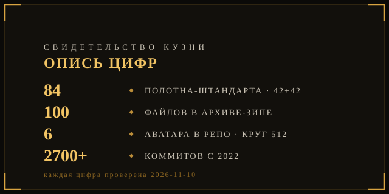</td>
<td width="50%"></td>
</tr>
</table>

> Ни одного стороннего виджета: эмблема, лента девизов и капсулы выкованы вручную.
> Каждый блок — один self-contained SVG, анимация встроена в файл и работает прямо в ``.

  

## FLAGSHIPS

<table>
<tr>
<td colspan="2">
  

<!--ФОРЖ:МУЗА:НАЧАЛО-->

  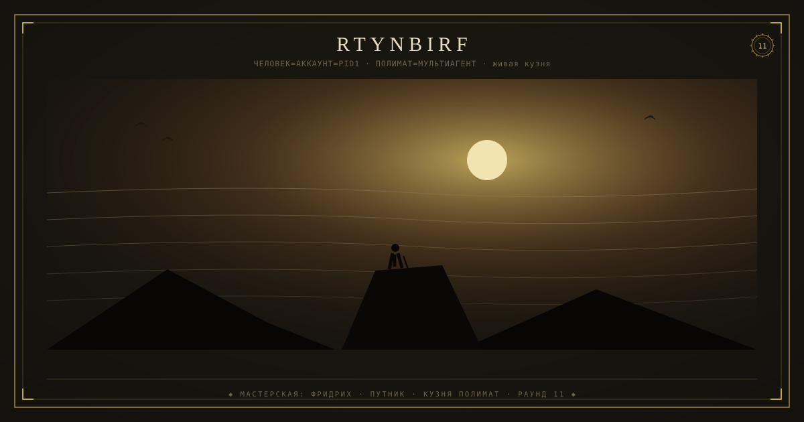
   
  

<!--ФОРЖ:МУЗА:КОНЕЦ-->

  <b>polymath-multiagent</b> — parallel agent orchestration, «одно другое не исключает» · <code>MCP-server</code> <code>SSE-dashboard</code> <code>stdlib-only</code> <code>19 tests green</code>
</td>
</tr>
<tr>
<td width="50%">
  
  <b>polymath-gen</b> — autonomous media agent with self-critique loop · <code>Python</code> <code>GLM-4V</code> <code>ComfyUI</code>
</td>
<td width="50%">
  
  <b>singulyar</b> — offline karaoke universe RUVSON · <code>PWA</code> <code>Offline-first</code> <code>64 songs</code>
</td>
</tr>
<tr>
<td width="50%">
  
  <b>polymath-tools-atlas</b> — 665 AI tools, evidence-ranked · <code>Research</code> <code>Proof-chains</code>
</td>
<td width="50%">
  
  <b>cell-swarm</b> — emergent repo organism · <code>Swarm</code> <code>stdlib-only</code>
</td>
</tr>
<tr>
<td width="50%">
  
  <b>voice-atlas-llm</b> — voice cloning expert LLM · <code>TTS/VC/SVC/SVS</code> <code>LoRA</code>
</td>
<td width="50%">
  
  <b>neutral-browser</b> — browser engine from scratch in Rust · <code>Rust</code> <code>0 deps</code>
</td>
</tr>
</table>

## РОЙ В СТРОЮ · живая шахматка

  

> 64 публичных флота из живого среза GitHub API · 2026-11-13 · свод открыт настежь — приватных 0 · счёт и дата — живой такт 2026-11-13, шахматка рядов — срез ковки · каждый блок — репозиторий с языком и весом · сумма, печать и кузня — в золотых ячейках.

## КАРТА СВЯЗЕЙ РОЯ · импульсы

  

  

## ШТАНДАРТЫ ФЛОТОВ · OBSIDIAN & MOLTEN GOLD

> Каждая репа несёт написанную картину-штандарт: барокко- chiaroscuro, обсидиан, расплавленное золото.
> Серия из **42 полотен** по канону РЕВО (LAYOUT → RENDER → CRITIC) · z-ai + PIL · 2026-11-10.

<table>
<tr>
<td width="50%">
  
  <b>OS</b> · sovereign machines — <a href="https://github.com/rtynbirf/polymath-os">polymath-os</a>
</td>
<td width="50%">
  
  <b>VAULT</b> · encrypted off-site archive — <a href="https://github.com/rtynbirf/release-vault">release-vault</a>
</td>
</tr>
<tr>
<td width="50%">
  
  <b>МЕТОД</b> · runnable-прототип метода — <a href="https://github.com/rtynbirf/revo">revo</a>
</td>
<td width="50%">
  
  <b>ВИТРИНА</b> · universal player — <a href="https://rtynbirf.github.io">rtynbirf.github.io</a>
</td>
</tr>
</table>

Полная галерея серии: <a href="https://github.com/rtynbirf/polimat-hub/blob/main/reports/banners-gallery-2026-11-10.png">42 полотна — сводный лист</a>

---

## DOCTRINE

> **Autonomy** — сущность работает без облака, сети и надзора.
> **Evidence** — каждое утверждение проверяется строкой, не смыслом.
> **Memory** — каждый прогон остаётся артефактом: `state.json`, `PULSE.md`.
> **Honesty** — недоделанное помечается недоделанным; фоллбек вместо вранья.

## СТЕК ВСЕЛЕННОЙ · чем построено

  
   
  
  
  
  
  

## КАРТА ВСЕЛЕННОЙ

  

## THE UNIVERSE · 6 кластеров · живой счёт в SWARM-SYNC ниже

| Cluster | Repositories |
|---|---|
| **SINGULAR** · offline karaoke | [`singulyar`](https://github.com/rtynbirf/singulyar) · [`ruvson-rse2`](https://github.com/rtynbirf/ruvson-rse2) · [`singulyar-llm`](https://github.com/rtynbirf/singulyar-llm) · [`karaoke-dream`](https://github.com/rtynbirf/karaoke-dream) · [`rumu`](https://github.com/rtynbirf/rumu) |
| **SWARM** · emergent organism | [`cell-swarm`](https://github.com/rtynbirf/cell-swarm) · [`cell-rs`](https://github.com/rtynbirf/cell-rs) · [`runtime-protocol`](https://github.com/rtynbirf/runtime-protocol) · [`commons`](https://github.com/rtynbirf/commons) |
| **ATLASES** · evidence-based | [`polymath-tools-atlas`](https://github.com/rtynbirf/polymath-tools-atlas) · [`voice-atlas-llm`](https://github.com/rtynbirf/voice-atlas-llm) · [`global-video-platforms-registry`](https://github.com/rtynbirf/global-video-platforms-registry) · [`polymath-atlas-v107`](https://github.com/rtynbirf/polymath-atlas-v107) |
| **OS** · sovereign machines | [`polymath-os`](https://github.com/rtynbirf/polymath-os) · [`os-forge`](https://github.com/rtynbirf/os-forge) · [`domovoy-tweaker`](https://github.com/rtynbirf/domovoy-tweaker) · [`neutral-browser`](https://github.com/rtynbirf/neutral-browser) · [`cell65-host`](https://github.com/rtynbirf/cell65-host) |
| **AGENTS** · autonomous minds | [`polymath-gen`](https://github.com/rtynbirf/polymath-gen) · [`universal-agent`](https://github.com/rtynbirf/universal-agent) · [`agryp`](https://github.com/rtynbirf/agryp) |
| **VAULT** · infra & archive | [`release-vault`](https://github.com/rtynbirf/release-vault) · [`markitdown`](https://github.com/rtynbirf/markitdown) |

## STATS

> Живая сверка чисел — в **SWARM-SYNC** ниже: суточная автогенерация по GitHub API, ни одного ручного числа. Языки, коммиты, топ-репо — там же.

  

  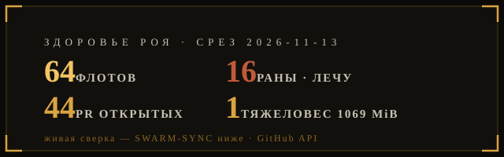

  

  

  

## ХРОНИКА КУЗНИ · ГОД ПЛАВКИ

  

> Последний сторонний виджет-график (vercel-генератор) заменён ручной ковкой: 53 недели из живого GraphQL, сканирующий луч, вспышки на горячих днях. Ни одного сервиса-генератора.

  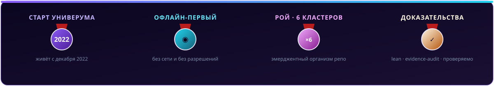

## ТЕРМИНАЛ РОЯ · живая neofetch-карта

  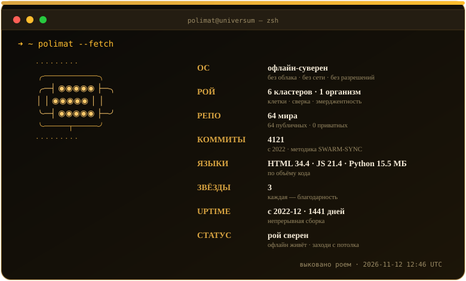

> Карта собирается собственным Action суточно по живому GitHub API — методика сверки та же, что у SWARM-SYNC, числа сходятся до единицы. Палитра — обсидиан и расплавленное золото ЖИВОЙ КУЗНИ.

## THE SWARM CRAWLS

<picture>
  <source media="(prefers-color-scheme: dark)" srcset="https://raw.githubusercontent.com/rtynbirf/rtynbirf/output/github-contribution-grid-snake-dark.svg">
  
</picture>

## СВЕТ ВСЕЛЕННОЙ · 3D

<picture>
  <source media="(prefers-color-scheme: dark)" srcset="https://raw.githubusercontent.com/rtynbirf/rtynbirf/main/profile-3d-contrib/profile-night-rainbow.svg">
  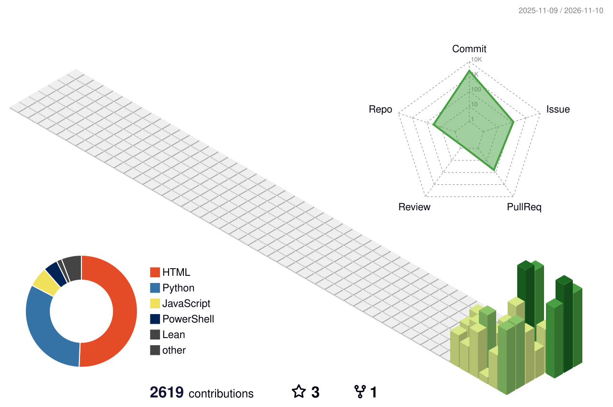
</picture>

---

  

<b><a href="https://rtynbirf.github.io">rtynbirf.github.io</a></b> — витрина вселенной · built by the swarm, for the swarm

<!--
ПОЛИМАТ: два слоя обложек — флагманы и штандарты фотов, серия OBSIDIAN & MOLTEN GOLD
(42 полотна по канону РЕВО: LAYOUT→RENDER→CRITIC, z-ai + PIL, 2026-11-10).
Хедер профиля — написанная картина polimat-header.png (обсидиан · золото · феникс-медальон).
Обновляется автономно при крупных тактах.-->

## ⚖ РИТУАЛ ДОМА

Поработал → сделал → убрал за собой. Такт замкнулся — дом в покое: ни одного уведомления,
ни одного хвоста. Формализовано как конечный автомат и исполняется машиной —
[**domovoy-ritual**](https://github.com/rtynbirf/domovoy-ritual): устав `RITUAL-FSM.md`
(7 состояний, guard-ы, 12 дефолтов «всё решаю сам») + `house_fsm.py` (stdlib-only).

<!-- SWARM:BEGIN автогенерация -->
## 🛰 SWARM-SYNC · сверка со средой
> Автогенерация 2026-11-12 13:01 UTC · источник: живой GitHub API · ни одного выдуманного числа

| Метрика | Значение |
|---|---|
| Репозиториев | **64** (64 публичных · 0 приватных) |
| Коммитов всего | **4129** |
| Последний push | 2026-11-12 |

**Языки по объёму кода:**
- `HTML` ██████████ 34.4 МБ
- `JavaScript` ██████ 21.4 МБ
- `Python` ████ 15.5 МБ
- `Lean` ██ 6.9 МБ
- `PowerShell` █ 2.2 МБ

**Топ-5 репо по коммитам (видимая работа):**
- **markitdown** — 452 коммитов · Python
- **H-PE11-PHOENIX** — 240 коммитов · PowerShell
- **polymath-os** — 223 коммитов · Python
- **cell-swarm** — 201 коммитов · Python
- **polimat-hub** — 175 коммитов · Python
<!-- SWARM:END -->

<!--ФОРЖ:ПОДВАЛ-->
---

  ◆ картина и штандарт — ручная ковка <a href="https://github.com/rtynbirf">КУЗНИ ПОЛИМАТ</a> · ЧЕЛОВЕК=АККАУНТ=PID1 ◆

<!--ФОРЖ:КАРТА-->
## КАРТА ДОМА

  

Все 64 комнаты дома несут свою написанную картину-музу. Раунд 11: каждая муза переписана заново — 64 полотна в 64 собственных мастерских великих школ (швейцарская точность, Хокусай, Климт, Малевич, Лисицкий, Калдер, Пиранези, Клее, оп-арт и другие законы), двух похожих рядом нет. 22 живая светится, 42 под сводом архива одеты и заперты — красота без нарушения дислокации; на карте спящие звёзды носят золотые кольца. Угольная звезда rumu спит одетой — проснулась по слову Хозяина и легла обратно.
