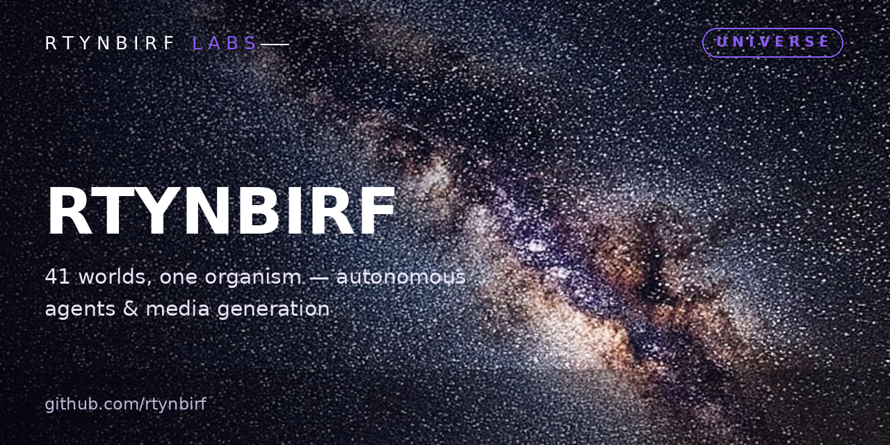

  

# rtynbirf · AUTONOMOUS SYSTEMS LAB

**Autonomous agents · Generative media · Offline sovereignty.**
«Строю то, что работает без интернета и без разрешений.»

---

## FLAGSHIPS

<table>
<tr>
<td width="50%">
  
  <b>polymath-gen</b> — autonomous media agent with self-critique loop · <code>Python</code> <code>GLM-4V</code> <code>ComfyUI</code>
</td>
<td width="50%">
  
  <b>singulyar</b> — offline karaoke universe RUVSON · <code>PWA</code> <code>Offline-first</code> <code>64 songs</code>
</td>
</tr>
<tr>
<td width="50%">
  
  <b>polymath-tools-atlas</b> — 665 AI tools, evidence-ranked · <code>Research</code> <code>Proof-chains</code>
</td>
<td width="50%">
  
  <b>cell-swarm</b> — emergent repo organism · <code>Swarm</code> <code>stdlib-only</code>
</td>
</tr>
<tr>
<td width="50%">
  
  <b>voice-atlas-llm</b> — voice cloning expert LLM · <code>TTS/VC/SVC/SVS</code> <code>LoRA</code>
</td>
<td width="50%">
  
  <b>neutral-browser</b> — browser engine from scratch in Rust · <code>Rust</code> <code>0 deps</code>
</td>
</tr>
</table>

## DOCTRINE

> **Autonomy** — сущность работает без облака, сети и надзора.
> **Evidence** — каждое утверждение проверяется строкой, не смыслом.
> **Memory** — каждый прогон остаётся артефактом: `state.json`, `PULSE.md`.
> **Honesty** — недоделанное помечается недоделанным; фоллбек вместо вранья.

## THE UNIVERSE · 26 public repos · 6 clusters

| Cluster | Repositories |
|---|---|
| **SINGULAR** · offline karaoke | [`singulyar`](https://github.com/rtynbirf/singulyar) · [`ruvson-rse2`](https://github.com/rtynbirf/ruvson-rse2) · [`singulyar-llm`](https://github.com/rtynbirf/singulyar-llm) · [`karaoke-dream`](https://github.com/rtynbirf/karaoke-dream) · [`rumu`](https://github.com/rtynbirf/rumu) |
| **SWARM** · emergent organism | [`cell-swarm`](https://github.com/rtynbirf/cell-swarm) · [`cell-rs`](https://github.com/rtynbirf/cell-rs) · [`runtime-protocol`](https://github.com/rtynbirf/runtime-protocol) · [`commons`](https://github.com/rtynbirf/commons) |
| **ATLASES** · evidence-based | [`polymath-tools-atlas`](https://github.com/rtynbirf/polymath-tools-atlas) · [`voice-atlas-llm`](https://github.com/rtynbirf/voice-atlas-llm) · [`global-video-platforms-registry`](https://github.com/rtynbirf/global-video-platforms-registry) · [`polymath-atlas-v107`](https://github.com/rtynbirf/polymath-atlas-v107) |
| **OS** · sovereign machines | [`polymath-os`](https://github.com/rtynbirf/polymath-os) · [`os-forge`](https://github.com/rtynbirf/os-forge) · [`domovoy-tweaker`](https://github.com/rtynbirf/domovoy-tweaker) · [`neutral-browser`](https://github.com/rtynbirf/neutral-browser) · [`cell65-host`](https://github.com/rtynbirf/cell65-host) |
| **AGENTS** · autonomous minds | [`polymath-gen`](https://github.com/rtynbirf/polymath-gen) · [`universal-agent`](https://github.com/rtynbirf/universal-agent) · [`agryp`](https://github.com/rtynbirf/agryp) |
| **VAULT** · infra & archive | [`release-vault`](https://github.com/rtynbirf/release-vault) · [`markitdown`](https://github.com/rtynbirf/markitdown) |

## STATS

<table>
<tr>
<td></td>
<td></td>
</tr>
</table>

## THE SWARM CRAWLS

<picture>
  <source media="(prefers-color-scheme: dark)" srcset="https://raw.githubusercontent.com/rtynbirf/rtynbirf/output/github-contribution-grid-snake-dark.svg">
  
</picture>

---

<b><a href="https://rtynbirf.github.io">rtynbirf.github.io</a></b> — витрина вселенной · built by the swarm, for the swarm

<!--
ПОЛИМАТ: обложки флагманов — серия RTYNBIRF LABS (1280x640, единая дизайн-система).
Каждый flagship-репо несёт .github/social-preview.png той же серии.
Обновляется автономно при крупных тактах.
-->

<!-- SWARM:BEGIN автогенерация -->
## 🛰 SWARM-SYNC · сверка со средой
> Автогенерация 2026-11-08 12:23 UTC · источник: живой GitHub API · ни одного выдуманного числа

| Метрика | Значение |
|---|---|
| Репозиториев | **41** (26 публичных · 15 приватных) |
| Коммитов всего | **2747** |
| Последний push | 2026-11-08 |

**Языки по объёму кода:**
- `HTML` ██████████ 28.6 МБ
- `JavaScript` ████ 10.8 МБ
- `Python` ███ 9.2 МБ
- `PowerShell` █ 1.2 МБ
- `Rust` █ 0.5 МБ

**Топ-5 репо по коммитам (видимая работа):**
- **singulyar** — 767 коммитов · HTML
- **markitdown** — 431 коммитов · Python
- **H-PE11-PHOENIX** 🔒 — 181 коммитов · PowerShell
- **polymath-os** — 156 коммитов · Python
- **commons** — 139 коммитов · Python
<!-- SWARM:END -->
