

  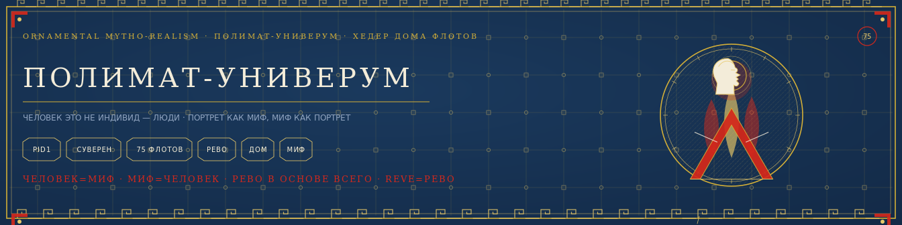

<!--ФОРЖ:АККАУНТ:НАЧАЛО-->

  

| РЕПО | ЖИВЫХ | МАСТЕРСКИХ | ОБНОВЛЕНО |
|---:|---:|---:|---|
| 81 | 80 | 73 | 2026-11-23 |
<!--ФОРЖ:АККАУНТ:КОНЕЦ-->

<!--НОО:ПУЛЬТ:НАЧАЛО-->

  
<b>◇ НООСЕТКА · ПУЛЬТ МИРОВ (С189)</b> — состояние каждого мира <i>вымеряется</i>, не декларируется:
  ядро качает манифест → ядро → стражей → поверхность и говорит правду: <code>GHOST → WIRE → LIVE → READY</code>, отказ → <code>DEGRADED</code> с причиной, архив → <code>SEALED</code>.
  Живая карта с промером в реальном времени: <a href="https://rtynbirf.github.io/singulyar/%D0%9D%D0%9E%D0%9E%D0%A1%D0%95%D0%A2%D0%9A%D0%90.html"><b>rtynbirf.github.io/singulyar/НООСЕТКА.html</b></a> ·
  брайль-строка дома (канон <code>latin-g1</code>): <b>⠗⠑⠁⠙⠽⠀⠀⠀⠀⠀⠀⠀⠀⠀⠀⠀⠀⠀⠀⠀⠀⠀⠀⠀⠀⠀⠀⠀⠀⠀⠀⠀⠀⠀⠀⠀⠀⠀⠀⠀⠀⠀⠀⠀⠀⠀⠀⠀⠀⠀⠀⠀⠀⠀⠀⠀⠀⠀⠀⠀⠀⠀⠀⠀⠀⠀⠀⠀⠀⠀⠀⠀⠀⠀⠀⠀⠀⠀⠀⠀⠀</b> = «READY»

  <table>
    <tr><th align="left">МИР (81)</th><th align="left">СТУПЕНЬ (бейдж читает committed JSON — бейдж не может соврать)</th><th align="left">РОЛЬ</th></tr>
| [`.github`](https://github.com/rtynbirf/.github) |  | .github — дефолтные community health files |
| [`agryp`](https://github.com/rtynbirf/agryp) |  | agryp — неспящий супервизор агентов уровня PID 1 |
| [`assembly-protocol`](https://github.com/rtynbirf/assembly-protocol) |  | Верификация через исполнение: протокол сборки v7. Двое независимых исполнителей, шесть вер |
| [`cell-rs`](https://github.com/rtynbirf/cell-rs) |  | Первая Rust-клетка роя: ядро контура сверки — Tolerance/reconcile/Phase, sha256, байт-цепь |
| [`cell-swarm`](https://github.com/rtynbirf/cell-swarm) |  | РОЙ (Cell Swarm) — сингулярная эмерджентная архитектура: клетка, окно, указатели, храповик |
| [`cell65-host`](https://github.com/rtynbirf/cell65-host) |  | cell65-host — Антицензор (Chrome MV3): PAC/DNR/WebRTC-защита, hosts-блокировка, обход блок |
| [`code`](https://github.com/rtynbirf/code) |  | Код дома: скрипты и снипеты — место по канону §4 |
| [`combain-v2`](https://github.com/rtynbirf/combain-v2) |  | COMBAIN v2 — self-hosted messenger |
| [`commons`](https://github.com/rtynbirf/commons) |  | COMMONS — один организм из лучших открытых проектов: геном-спеки, синапсы MCP, кровь событ |
| [`dogovor`](https://github.com/rtynbirf/dogovor) |  | Договор агента: правила, которыми роя связывает себя сам. Правило = карточка 6 строк + авт |
| [`domovenok`](https://github.com/rtynbirf/domovenok) |  | 🏠 Командный центр дома: задачи, комнаты, расходы и индекс порядка. Next.js 16 · TypeScript |
| [`domovoy`](https://github.com/rtynbirf/domovoy) |  | КНИГА ДОМОВОГО |
| [`domovoy-ritual`](https://github.com/rtynbirf/domovoy-ritual) |  | Ритуал дома как конечный автомат: поработал → сделал → убрал за собой. S0-покой гарантиров |
| [`domovoy-tweaker`](https://github.com/rtynbirf/domovoy-tweaker) |  | ДОМОВОЙ / MEGA=TWEAKER — Windows tweaker as a state, not an event: change ledger, drift se |
| [`door-zero`](https://github.com/rtynbirf/door-zero) |  | Door Zero: дверь без контента. PID 0 системы: удаление ломает boot. GET -> 204, POST/PUT - |
| [`edinyy-svod`](https://github.com/rtynbirf/edinyy-svod) |  | ЕДИНЫЙ СВОД — Конституция Хозяина 4.2: основной закон стенда «ЕДИНЫЙ ХОЗЯИН», 98 статей, X |
| [`ekonomika`](https://github.com/rtynbirf/ekonomika) |  | КНИГА ЭКОНОМИКИ |
| [`ekspozicii`](https://github.com/rtynbirf/ekspozicii) |  | КНИГА ЭКСПОЗИЦИЙ |
| [`fond-host`](https://github.com/rtynbirf/fond-host) |  | CORS-хост минус-фонда дома (Н-10 · ADR-0007): Pages отдаёт ACAO:* для лестницы WebAudio пл |
| [`free-man`](https://github.com/rtynbirf/free-man) |  | FREE MAN 0.2.2 — browser autonomy for Chrome MV3. 108 tracker/ads/CNAME domains blocked 10 |
| [`github-doctrine`](https://github.com/rtynbirf/github-doctrine) |  | КНИГА ДОКТРИНЫ |
| [`github-runbook`](https://github.com/rtynbirf/github-runbook) |  | Ранбук: настройка GitHub-репозитория человеком для человека — все флаги Settings, ветки и  |
| [`global-practice-atlas`](https://github.com/rtynbirf/global-practice-atlas) |  | Глобальный атлас практик 2026 (v1.6): 1145 живых позиций из 1154 строк, 9 поглощений с сох |
| [`global-video-platforms-registry`](https://github.com/rtynbirf/global-video-platforms-registry) |  | Верифицированный реестр 1071 видеоплатформ (1032 активных) — окт 2026. CSV/JSON/XLSX/PDF + |
| [`H-PE11-PHOENIX`](https://github.com/rtynbirf/H-PE11-PHOENIX) |  | PHOENIX-11: ворклог операций TH-* (журнал неповторимых результатов), сборки WinPE, сессии. |
| [`hologram`](https://github.com/rtynbirf/hologram) |  | осколок знает целое: Merkle-осколки + Рид-Соломон (Целое из любых k из n), 64 репо вселенн |
| [`index`](https://github.com/rtynbirf/index) |  | SSOT-хаб: реестр проектов, проверенные SHA, конституция веса |
| [`inv-automat`](https://github.com/rtynbirf/inv-automat) |  | КОНЕЧНЫЙ АВТОМАТ инвентаризации: живой GitHub API → claims-сверка → append-only ledger → P |
| [`invariant-manifest`](https://github.com/rtynbirf/invariant-manifest) |  | МАНИФЕСТ ИНВАРИАНТА · FORK 3 · v0.2.3 · CONDITIONAL PASS · seed 7170 · stdlib-only · порож |
| [`karaoke-dream`](https://github.com/rtynbirf/karaoke-dream) |  | Браузерное караоке мечты: неон, гид-вокал, оценка голоса в реальном времени и Зелёный кори |
| [`karta`](https://github.com/rtynbirf/karta) |  | КАРТА ВСЕЛЕННОЙ rtynbirf: генерируется из живых данных API, ни одного выдуманного числа. С |
| [`kb`](https://github.com/rtynbirf/kb) |  | Знания дома: канон-тексты, гайды, досье — место по канону §4 |
| [`khozyain`](https://github.com/rtynbirf/khozyain) |  | ХОЗЯИН ДОМА — аккаунт-уровневый автомат состояния: зелёные main, живые триггеры, ноль откр |
| [`language-through-the-ages`](https://github.com/rtynbirf/language-through-the-ages) |  | Язык сквозь эпохи — автономная HTML-экспозиция: семь способов мыслить язык (7 эпох × 7 гар |
| [`lean-canon`](https://github.com/rtynbirf/lean-canon) |  | КНИГА LEAN-КАНОНА |
| [`lex-naturae`](https://github.com/rtynbirf/lex-naturae) |  | Lex Naturae — claim/evidence ledger. Separates observations from hypotheses, philosophical |
| [`lfs-core`](https://github.com/rtynbirf/lfs-core) |  | Испытательный стенд автономного агента: цель/обязательство/пересмотр измеряются, а не декл |
| [`linguistic-code`](https://github.com/rtynbirf/linguistic-code) |  | Самодостаточный философский артефакт о языке, теле и опыте. δ requires body. |
| [`markitdown`](https://github.com/rtynbirf/markitdown) |  | MarkItDown |
| [`meta-layer-kit`](https://github.com/rtynbirf/meta-layer-kit) |  | meta-layer-kit: единый ZIP набора мета-управления |
| [`neutral-browser`](https://github.com/rtynbirf/neutral-browser) |  | Neutral Browser — НЕЙТРАЛЬНЫЙ БРАУЗЕР ПОЛЬЗОВАТЕЛЯ |
| [`nous`](https://github.com/rtynbirf/nous) |  | НОУС — эмерджентное сингулярное репо: конституция для человека и агентов, ТЗ форжа ISO, до |
| [`os-forge`](https://github.com/rtynbirf/os-forge) |  | OS-FORGE v0.1.1 — самодостаточный автономный батник: карта среды (железо+ОС по фактам) → р |
| [`polimat-hub`](https://github.com/rtynbirf/polimat-hub) |  | POLIMAT-HUB: место сверок мультиагента-архитектора. Архитектура, журнал операций, пломбы,  |
| [`polimat-task174`](https://github.com/rtynbirf/polimat-task174) |  | ПОЛИМАТ · TASK174 — протокол проверки канона по строкам: пломбы sha256, ловушки, Б25.8 при |
| [`polymat-hive`](https://github.com/rtynbirf/polymat-hive) |  | 🐝 Живой репозиторий-организм: экипаж автономных AI-агентов в GitHub Actions — Copilot, лок |
| [`polymath-atlas`](https://github.com/rtynbirf/polymath-atlas) |  | Operational System Atlas - Lean 4 Gestalt audit: 7 modules, zero sorry, verbatim imperial  |
| [`POLYMATH-ATLAS-GESTALT-CANON`](https://github.com/rtynbirf/POLYMATH-ATLAS-GESTALT-CANON) |  | Полимат-Атлас-Гештальт-Канон: Lean 4 формальный канон (301 модуль, 55388 строк, 2916 теоре |
| [`polymath-atlas-v107`](https://github.com/rtynbirf/polymath-atlas-v107) |  | POLYMATH-ATLAS v107.1-FINAL — honest evidence-audit framework in Lean 4. VERIFIED ENGINEER |
| [`polymath-core`](https://github.com/rtynbirf/polymath-core) |  | КНИГА ПОЛИМАТ-ЯДРА |
| [`polymath-gen`](https://github.com/rtynbirf/polymath-gen) |  | ПОЛИМАТ-ГЕН: автономный медиа-агент — задание человека -> промпт -> изображение/видео -> с |
| [`polymath-multiagent`](https://github.com/rtynbirf/polymath-multiagent) |  | 🧠 Полимат = Мультиагент — параллельная оркестрация ИИ-агентов, где одно другое не исключае |
| [`polymath-os`](https://github.com/rtynbirf/polymath-os) |  | Personal sovereign media-OS. 5-layer LFS-style self-bootstrapping repo. SINGULYAR Emergent |
| [`polymath-stckg-core`](https://github.com/rtynbirf/polymath-stckg-core) |  | ST-CKG → Lean 4 bridge contract: 11 machine-verified theorems, 0 sorry, kernel-audited axi |
| [`polymath-tools-atlas`](https://github.com/rtynbirf/polymath-tools-atlas) |  | ПОЛИМАТ · TOOLS-ATLAS — каталог 665 AI-инструментов по контракту ГОЛОГРАММА v1 (6 слоёв, 3 |
| [`red-thread-debt-audit`](https://github.com/rtynbirf/red-thread-debt-audit) |  | КРАСНАЯ НИТЬ — аудит динамики суверенного долга: долговая яма = рента. Канон v8.0, матрица |
| [`release-vault`](https://github.com/rtynbirf/release-vault) |  | release-vault — Шифрованное хранилище релизных ассетов |
| [`relomat`](https://github.com/rtynbirf/relomat) |  | РЕЛОМАТ — канон типизированных отношений как конечный детерминированный автомат: SAME, IS- |
| [`rent-mechanism-q43`](https://github.com/rtynbirf/rent-mechanism-q43) |  | Рентный механизм: ядро Q43 v2, шесть законов L1-L6, инвариант I_K. Машинная программа R11- |
| [`repo-doctrine`](https://github.com/rtynbirf/repo-doctrine) |  | Доктрина настройки GitHub-репозиториев: человеком для человека. Чек-листы флагов, защита в |
| [`repo-seed`](https://github.com/rtynbirf/repo-seed) |  | Зерно дома: шаблон новорождённого — мембрана+CI+закон рождения (принцип №7 канона 27). Use |
| [`revo`](https://github.com/rtynbirf/revo) |  | REVO — автономный прототип метода Reve: layout → render |
| [`rtynbirf`](https://github.com/rtynbirf/rtynbirf) |  | ЧЕЛОВЕК=АККАУНТ=PID1 · ПОЛИМАТ=МУЛЬТИАГЕНТ · живая кузня: рой агентов, офлайн-вселенная, н |
| [`rtynbirf.github.io`](https://github.com/rtynbirf/rtynbirf.github.io) |  | ЛАКОРНИЯ · MEGA-PLAYER SINGULYAR |
| [`rumu`](https://github.com/rtynbirf/rumu) |  | ⚡ СИНГУЛЯР РУМУ — Sovereign BL/GL Streaming. P2P+autopilot, NO corporate. 249 тайтлов. Дер |
| [`runtime-protocol`](https://github.com/rtynbirf/runtime-protocol) |  | Клетка роя cell-swarm: исполнимая модель динамики узла (уравнение ρ̇, GENESIS_EXEC, VOLATI |
| [`ruvson`](https://github.com/rtynbirf/ruvson) |  | КНИГА RUVSON |
| [`ruvson-lyrics`](https://github.com/rtynbirf/ruvson-lyrics) |  | RUVSON — тексты 65 треков: черновики, пайплайн, финальный ZIP |
| [`ruvson-rse2`](https://github.com/rtynbirf/ruvson-rse2) |  | RUVSON SINGULARITY ENGINE v2 (RSE-2): станок одной песни Шаг 0-6 на мировых трендах 2023-2 |
| [`singulyar`](https://github.com/rtynbirf/singulyar) |  | СИНГУЛЯР — офлайн-вселенная караоке RUVSON: 68 песен · 197 языков (цель 200) · ОРКЕСТРАТОР |
| [`singulyar-a0-audit`](https://github.com/rtynbirf/singulyar-a0-audit) |  | SINGULYAR × A0 — independent audit (PACKAGE VALID + BRIDGE VALID) and R4 port design |
| [`singulyar-llm`](https://github.com/rtynbirf/singulyar-llm) |  | Локальная модель СИНГУЛЯРА: Qwen2.5-0.5B-Instruct GGUF частями + инструкционный слой (ОБУЧ |
| [`task-graph-propagator`](https://github.com/rtynbirf/task-graph-propagator) |  | Task Graph Engine: один пропагатор — все функции структуры графа задач (полукольца, Кана,  |
| [`uace`](https://github.com/rtynbirf/uace) |  | КНИГА UACE |
| [`uace-pml`](https://github.com/rtynbirf/uace-pml) |  | UACE x PML — Universal AI Chat Exporter (Evidence First, PML-PANEL 1.0 / PML-STRUCT canon) |
| [`uace-polymat`](https://github.com/rtynbirf/uace-polymat) |  | UACE x PML — POLYMAT UNIFIED userscripts + Cookie Vault MV3 extension. 0 network. Machine- |
| [`universal-agent`](https://github.com/rtynbirf/universal-agent) | `SEALED` · архив (заморожен владельцем, запись в архив закрыта GitHub) | UniversalAgent (TsUA) - single-brain holistic agent: one LLM core, closed perception-actio |
| [`voice-atlas-llm`](https://github.com/rtynbirf/voice-atlas-llm) |  | Атлас-LLM: модель-эксперт по клонированию голоса (дизентанглмент, TTS/VC/SVC/SVS) — LoRA-о |
| [`web-evolution-1991-2026`](https://github.com/rtynbirf/web-evolution-1991-2026) |  | Эволюция Веба 1991→2026 — автономная HTML-экспозиция: 5 эпох, таймлайн, WCAG+APCA, один фа |
| [`windows-chronicle`](https://github.com/rtynbirf/windows-chronicle) |  | Полная хроника Microsoft Windows 1985-2026: все версии, боли пользователей, продвижение, р |
| [`yazyk-skvoz-epohi`](https://github.com/rtynbirf/yazyk-skvoz-epohi) |  | Язык сквозь эпохи · Дом-Автомат v21 — семиэпохальное эссе, построенное как детерминированн |
  </table>
  
манифесты: <code>noo-manifest.json</code> в каждом репо · ядро: <code>noo-kernel.js</code> (браузер+Node, ноль зависимостей) ·
  реестр: <a href="https://github.com/rtynbirf/singulyar/blob/rumu/noo/миры.json">noo/миры.json</a> ·
  репо без манифеста сетка видит как <code>GHOST</code> — интеграция проверяется сама собой

<!--НОО:ПУЛЬТ:КОНЕЦ-->

<!--АТЛАС:КАРТА:НАЧАЛО-->

  
  
КАРТА=ТЕРРИТОРИИ · МОДЕЛЬ=РЕАЛЬНОСТЬ — <a href="https://github.com/rtynbirf/global-practice-atlas">global-practice-atlas</a> · <a href="https://github.com/rtynbirf/relomat">relomat</a> · SVG перерисовывается на автомате из данных атласа

<!--АТЛАС:КАРТА:КОНЕЦ-->

<!--КАРТЫ:НАЧАЛО-->

  
<b>КАРТЫ НА СТОЛ · три захода (20.11.2026)</b> — отчёты в корне: <code>КАРТЫ-НА-СТОЛ/</code> ·
  заход 1: дом против мировых практик (7 источников) · дубль два: антигаллюцинация, 14 клеймов
  живыми уликами (7 / 5 / 2) + эмерджентный синтез · заход 3: механизм — правила 23–27 в закон,
  СТРАЖ СПЯЩИХ (приказ ≠ болезнь: 216 приказов пересчитаны, 0 болезней, kick тихой смерти —
  РЁВО-АВТОМАТ), ТРЕБОВАНИЯ-ДЛЯ-АГЕНТОВ.md. Счёт: 5,4 → 5,8 · закон: AGENTS.md 1–27 · REVE=РЕВО

<!--КАРТЫ:КОНЕЦ-->

<!--INV:АВТОМАТ:НАЧАЛО-->

  <a href="https://github.com/rtynbirf/inv-automat">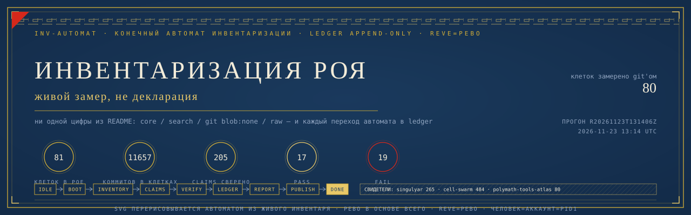</a>
  
🧬 КОНЕЧНЫЙ АВТОМАТ: <a href="https://github.com/rtynbirf/inv-automat">rtynbirf/inv-automat</a> — таблица переходов <code>IDLE→BOOT→INVENTORY→CLAIMS→VERIFY→LEDGER→REPORT→PUBLISH→DONE</code> · 📄 живой отчёт: <a href="https://rtynbirf.github.io/inv-automat/">Pages</a> · 📜 <a href="https://github.com/rtynbirf/inv-automat/blob/main/automat/ledger/runs.jsonl">ledger переходов</a> (append-only) · свидетель в каждой живой клетке — SVG перерисовывается автоматом из живого инвентаря, ни одной цифры из README

<!--INV:АВТОМАТ:КОНЕЦ-->

# rtynbirf · AUTONOMOUS SYSTEMS LAB

**Autonomous agents · Generative media · Offline sovereignty.**
«Строю то, что работает без интернета и без разрешений.»

> **За 10 секунд.** Я — ЧЕЛОВЕК=АККАУНТ=PID1, живая кузня автономных систем.
> Главный проект — [polymath-os](https://github.com/rtynbirf/polymath-os): каждая строчка репо воспроизводима одной командой [`make verify`](https://github.com/rtynbirf/polymath-os/blob/main/Makefile) → 33/33 PASS · 295 тестов · 35 ADR · 5 слоёв.
> Живой дом — [СИНГУЛЯР](https://rtynbirf.github.io/singulyar/): офлайн-караоке-вселенная «Одна песня. 157 голосов. Одна правда.»

## ГЕНОМ РОЯ · 20 КЛЕТОК + 2 НОВОРОЖДЁННЫЕ — канон пинов профиля

| # | Клетка | Роль из тела генома |
|---|---|---|
| 1 | [`polymath-os`](https://github.com/rtynbirf/polymath-os) | substrate роя: ОС Человека — 5 слоёв + Decree Log (append-only, hash-chained, Ed25519) |
| 2 | [`singulyar`](https://github.com/rtynbirf/singulyar) | память роя: корпус 64 песни × 200 языков офлайн |
| 3 | [`singulyar-llm`](https://github.com/rtynbirf/singulyar-llm) | локальный инференс в браузере (Qwen) — кандидат в метаболизм роя |
| 4 | [`cell65-host`](https://github.com/rtynbirf/cell65-host) | суверенный узел-хост «настроил и забыл» |
| 5 | [`rumu`](https://github.com/rtynbirf/rumu) | держатель имени РУМУ — клетка-указатель, пин следит за телом |
| 6 | [`voice-atlas-llm`](https://github.com/rtynbirf/voice-atlas-llm) | атлас голосов: свой голос — при себе, чужой — только по согласию (A21 дома) |
| 7 | [`global-video-platforms-registry`](https://github.com/rtynbirf/global-video-platforms-registry) | реестр-указатель платформ: хаб хранит магниты, не контент |
| 8 | [`commons`](https://github.com/rtynbirf/commons) | дом: организм из лучших открытых проектов, якорь моста (ADR-0006) |
| 9 | [`runtime-protocol`](https://github.com/rtynbirf/runtime-protocol) | исполнимая модель динамики узла: уравнение ρ̇, фазовая машина GENESIS_EXEC |
| 10 | [`cell-rs`](https://github.com/rtynbirf/cell-rs) | первая Rust-клетка: ядро контура сверки, байт-цепь на векторах NIST |
| 11 | [`agryp`](https://github.com/rtynbirf/agryp) | процесс-супервизор агентов роя (PID 1): один файл C, только libc, ноль зависимостей |
| 12 | [`lex-naturae`](https://github.com/rtynbirf/lex-naturae) | законник дома: claim/evidence ledger — отделяет наблюдения от гипотез · 70/70 тестов · аудит v0.7 Z.ai |
| 13 | [`singulyar-a0-audit`](https://github.com/rtynbirf/singulyar-a0-audit) | независимый аудитор роя: A0-аудит СИНГУЛЯРА PACKAGE VALID + BRIDGE VALID · свидетель, не автор |
| 14 | [`fond-host`](https://github.com/rtynbirf/fond-host) | CORS-хост минус-фонда (Н-10 · ADR-0007): Pages отдаёт ACAO:* для лестницы WebAudio-плееров |
| 15 | [`code`](https://github.com/rtynbirf/code) | код дома: скрипты и снипеты — место по канону §4 |
| 16 | [`invariant-manifest`](https://github.com/rtynbirf/invariant-manifest) | механический судья инвариантов: hash-chain + mutation-testing, вердикт CONDITIONAL PASS |
| 17 | [`karta`](https://github.com/rtynbirf/karta) | карта вселенной роя: генерируется из живого API, ssot — ни одного выдуманного числа |
| 18 | [`kb`](https://github.com/rtynbirf/kb) | знания дома: канон-тексты, гайды, досье — база знаний роя |
| 19 | [`lfs-core`](https://github.com/rtynbirf/lfs-core) | испытательный стенд автономного агента: цель/обязательство/пересмотр измеряются, а не декларируются |
| 20 | [`repo-seed`](https://github.com/rtynbirf/repo-seed) | зерно дома: шаблон новорождённого — мембрана+CI+закон рождения (принцип №7 канона 27) |
| 21 · новорождённая | [`global-practice-atlas`](https://github.com/rtynbirf/global-practice-atlas) | карта=территория роя: глобальный атлас практик 2026 — 1154 строки / 1145 живых, РЕЛОМАТ 43/43 · 11/11, скан 660,675 пар, релизы v1.6; виджет профиля перерисовывается из его данных |
| 22 · новорождённая | [`relomat`](https://github.com/rtynbirf/relomat) | канон как конечный детерминированный автомат: SAME/IS-A/TOOL-OF… вердикты; судья всех слияний атласа, CI исполняет его независимо |

> **ПИН-РАСКЛАД · 6 клеток (руками в веб-интерфейсе — API пинов не существует):** `polymath-os` · `singulyar` · `global-practice-atlas` · `relomat` · `karta` · `voice-atlas-llm`. Клетки 21–22 зачислены в хеш-цепь: ратчет исполнен 2026-11-20 (пины от живого HEAD, integrity по формуле).

> Роли — из тела генома (swarm.json, храповик пинов, 0.2.17 · 22 клетки, канон c24dfbc4b4e5bc1d; пины от живого HEAD, integrity sha256(hex(utf8(pin))) пересчитана 22/22 (заноза make pins закрыта) — волна-13б + ратчет и догон genome-drift 2026-11-20). Пины профиля API не выставляет
> (GraphQL: 269 мутаций без профильных; REST: все каналы 404 — проба 2026-11-16) — канон держит лицо.

  

  

  

  

  

  

## ЗАХОДИ С ПОТОЛКА

> Ты здесь случайно — и это лучший способ зайти. Три двери:

| 🎼 Послушать | 🤖 Изучить роя | 🗺 Открыть всё |
|---|---|---|
| [**СИНГУЛЯР**](https://rtynbirf.github.io) — офлайн-караоке прямо в браузере, ничего не нужно устанавливать | [**cell-swarm**](https://github.com/rtynbirf/cell-swarm) — эмерджентная архитектура роя клеток | [**ЕДИНЫЙ СВОД**](https://github.com/rtynbirf/edinyy-svod) — каталог всех миров вселенной |

<!-- HIVE:BEGIN живой эксперимент · polymat-hive -->
## 🧫 ЖИВОЙ ЭКСПЕРИМЕНТ

**[ПОЛИМАТ-УЛЕЙ](https://github.com/rtynbirf/polymat-hive)** — репозиторий-организм: экипаж автономных AI-агентов живёт в GitHub Actions и думает **трёхэтажным мозгом**: Copilot CLI → локальный GGUF-нейромозг (Qwen2.5-0.5B прямо на раннере, без ключей и серверов) → инстинкты. Открой [issue](https://github.com/rtynbirf/polymat-hive/issues/new?template=hive-message.yml) — экипаж ответит: метка, резюме, план.

  

<!-- HIVE:END -->

<!-- HEALTH:BEGIN автогенерация · swarm_health.json · scripts/health_badges.py -->
   
<!-- HEALTH:END -->

---

## ЖИВАЯ КУЗНЯ · BENTO

<table>
<tr>
<td width="50%"></td>
<td width="50%"></td>
</tr>
<tr>
<td width="50%">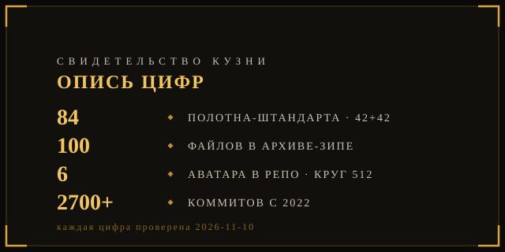</td>
<td width="50%"></td>
</tr>
</table>

> Ни одного стороннего виджета: эмблема, лента девизов и капсулы выкованы вручную.
> Каждый блок — один self-contained SVG, анимация встроена в файл и работает прямо в ``.

  

## FLAGSHIPS

<table>
<tr>
<td colspan="2">
  <a href="https://github.com/rtynbirf/polymath-multiagent">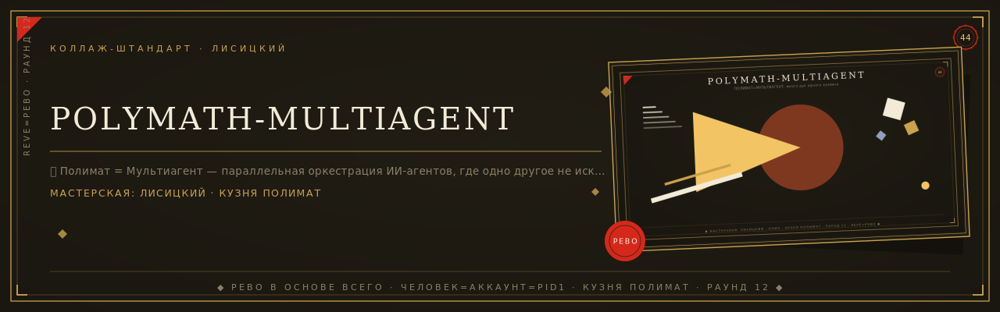</a>

<!--ФОРЖ:МУЗА:НАЧАЛО-->

  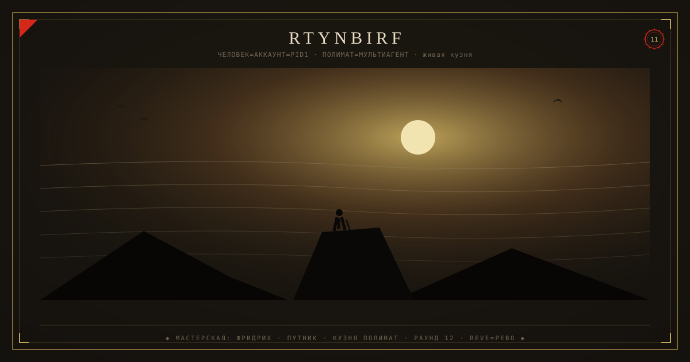
   
  

<!--ФОРЖ:МУЗА:КОНЕЦ-->

<!--ФОРЖ:ПАСПОРТ:НАЧАЛО-->

  

| ФАЙЛОВ | ПАПОК | КОММИТОВ | ОБНОВЛЕНО | РЕЛИЗОВ |
|---:|---:|---:|---|---:|
| 159 | 13 | 644 | 2026-11-25 | 0 |
<!--ФОРЖ:ПАСПОРТ:КОНЕЦ-->

  <b>polymath-multiagent</b> — parallel agent orchestration, «одно другое не исключает» · <code>MCP-server</code> <code>SSE-dashboard</code> <code>stdlib-only</code> <code>19 tests green</code>
</td>
</tr>
<tr>
<td width="50%">
  <a href="https://github.com/rtynbirf/polymath-gen">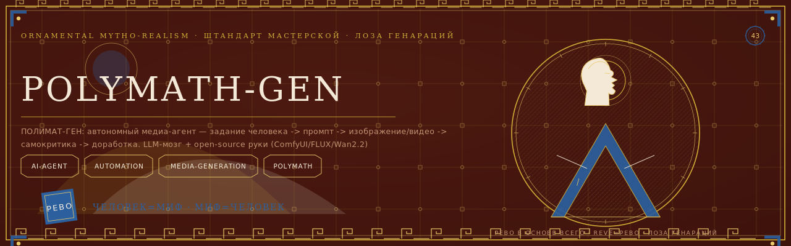</a>
  <b>polymath-gen</b> — autonomous media agent with self-critique loop · <code>Python</code> <code>GLM-4V</code> <code>ComfyUI</code>
</td>
<td width="50%">
  <a href="https://github.com/rtynbirf/singulyar">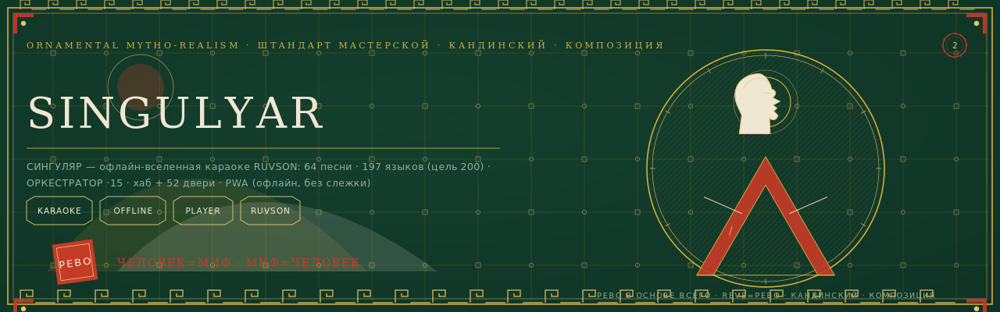</a>
  <b>singulyar</b> — offline karaoke universe RUVSON · <code>PWA</code> <code>Offline-first</code> <code>64 songs</code>
</td>
</tr>
<tr>
<td width="50%">
  <a href="https://github.com/rtynbirf/polymath-tools-atlas">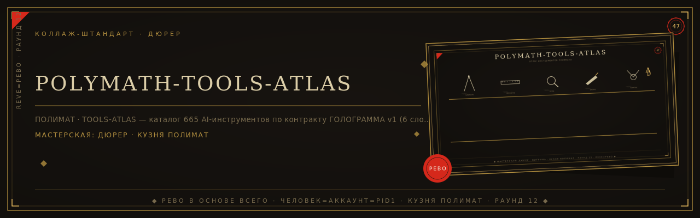</a>
  <b>polymath-tools-atlas</b> — 665 AI tools, evidence-ranked · <code>Research</code> <code>Proof-chains</code>
</td>
<td width="50%">
  
  <b>cell-swarm</b> — emergent repo organism · <code>Swarm</code> <code>stdlib-only</code>
</td>
</tr>
<tr>
<td width="50%">
  
  <b>voice-atlas-llm</b> — voice cloning expert LLM · <code>TTS/VC/SVC/SVS</code> <code>LoRA</code>
</td>
<td width="50%">
  <a href="https://github.com/rtynbirf/neutral-browser">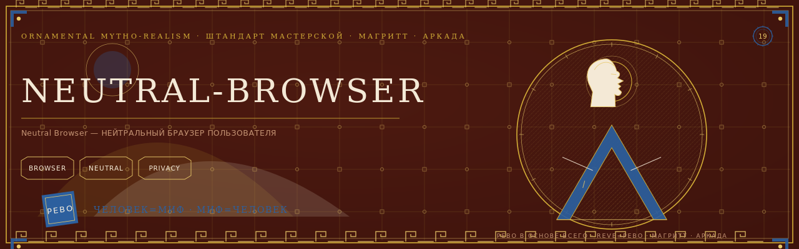</a>
  <b>neutral-browser</b> — browser engine from scratch in Rust · <code>Rust</code> <code>0 deps</code>
</td>
</tr>
</table>

## РОЙ В СТРОЮ · живая шахматка

  

> 81 публичных флота из живого среза GitHub API · 2026-11-24 · свод открыт настежь — приватных 0 · счёт и дата — живой такт 2026-11-24, шахматка рядов — срез ковки · каждый блок — репозиторий с языком и весом · сумма, печать и кузня — в золотых ячейках.

## КАРТА СВЯЗЕЙ РОЯ · импульсы

  

  

## ШТАНДАРТЫ ФЛОТОВ · ORNAMENTAL MYTHO-REALISM

> Каждая репа несёт написанную картину-штандарт в каноне ORNAMENTAL MYTHO-REALISM: решётка Сецессиона, гравюрный штрих, плоскость укиё-э, символистский миф · ЧЕЛОВЕК=МИФ, МИФ=ЧЕЛОВЕК.
> Серия выросла до **66 полотен** (2026-11-10 → 2026-11-16); с 16 ноября на каждой из **68 страниц** стоит
> **РЕВО-ПАСПОРТ** — изображение, выкованное из фактического контента страницы (файлы, папки, коммиты,
> лексикон README, топики) — и перекуется сам: **автопилот РЕВО v2** · REVE=РЕВО.

<table>
<tr>
<td width="50%">
  
  <b>OS</b> · sovereign machines — <a href="https://github.com/rtynbirf/polymath-os">polymath-os</a>
</td>
<td width="50%">
  
  <b>VAULT</b> · encrypted off-site archive — <a href="https://github.com/rtynbirf/release-vault">release-vault</a>
</td>
</tr>
<tr>
<td width="50%">
  <a href="https://github.com/rtynbirf/revo">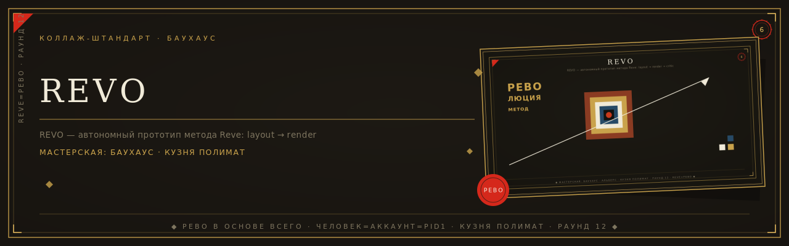</a>
  <b>МЕТОД</b> · runnable-прототип метода — <a href="https://github.com/rtynbirf/revo">revo</a>
</td>
<td width="50%">
  
  <b>ВИТРИНА</b> · universal player — <a href="https://rtynbirf.github.io">rtynbirf.github.io</a>
</td>
</tr>
</table>

Полная галерея серии: <a href="https://github.com/rtynbirf/polimat-hub/blob/main/reports/banners-gallery-2026-11-10.png">Галерея первых 42 полотен — сводный лист</a> · актуальная картина аккаунта — <a href="https://github.com/rtynbirf/rtynbirf/blob/main/revo-account.svg">паспорт выше</a>

---

## DOCTRINE

> **Autonomy** — сущность работает без облака, сети и надзора.
> **Evidence** — каждое утверждение проверяется строкой, не смыслом.
> **Memory** — каждый прогон остаётся артефактом: `state.json`, `PULSE.md`.
> **Honesty** — недоделанное помечается недоделанным; фоллбек вместо вранья.

## СТЕК ВСЕЛЕННОЙ · чем построено

  
   
  
  
  
  
  

## КАРТА ВСЕЛЕННОЙ

  

## THE UNIVERSE · 6 кластеров · живой счёт в SWARM-SYNC ниже

| Cluster | Repositories |
|---|---|
| **SINGULAR** · offline karaoke | [`singulyar`](https://github.com/rtynbirf/singulyar) · [`ruvson-rse2`](https://github.com/rtynbirf/ruvson-rse2) · [`singulyar-llm`](https://github.com/rtynbirf/singulyar-llm) · [`karaoke-dream`](https://github.com/rtynbirf/karaoke-dream) · [`rumu`](https://github.com/rtynbirf/rumu) |
| **SWARM** · emergent organism | [`cell-swarm`](https://github.com/rtynbirf/cell-swarm) · [`cell-rs`](https://github.com/rtynbirf/cell-rs) · [`runtime-protocol`](https://github.com/rtynbirf/runtime-protocol) · [`commons`](https://github.com/rtynbirf/commons) |
| **ATLASES** · evidence-based | [`polymath-tools-atlas`](https://github.com/rtynbirf/polymath-tools-atlas) · [`voice-atlas-llm`](https://github.com/rtynbirf/voice-atlas-llm) · [`global-video-platforms-registry`](https://github.com/rtynbirf/global-video-platforms-registry) · [`polymath-atlas-v107`](https://github.com/rtynbirf/polymath-atlas-v107) |
| **OS** · sovereign machines | [`polymath-os`](https://github.com/rtynbirf/polymath-os) · [`os-forge`](https://github.com/rtynbirf/os-forge) · [`domovoy-tweaker`](https://github.com/rtynbirf/domovoy-tweaker) · [`neutral-browser`](https://github.com/rtynbirf/neutral-browser) · [`cell65-host`](https://github.com/rtynbirf/cell65-host) |
| **AGENTS** · autonomous minds | [`polymath-gen`](https://github.com/rtynbirf/polymath-gen) · [`universal-agent`](https://github.com/rtynbirf/universal-agent) · [`agryp`](https://github.com/rtynbirf/agryp) |
| **VAULT** · infra & archive | [`release-vault`](https://github.com/rtynbirf/release-vault) · [`markitdown`](https://github.com/rtynbirf/markitdown) |

## STATS

> Живая сверка чисел — в **SWARM-SYNC** ниже: суточная автогенерация по GitHub API, ни одного ручного числа. Языки, коммиты, топ-репо — там же.

  

  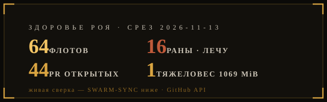

  

  

  

## ХРОНИКА КУЗНИ · ГОД ПЛАВКИ

  

> Последний сторонний виджет-график (vercel-генератор) заменён ручной ковкой: 53 недели из живого GraphQL, сканирующий луч, вспышки на горячих днях. Ни одного сервиса-генератора.

  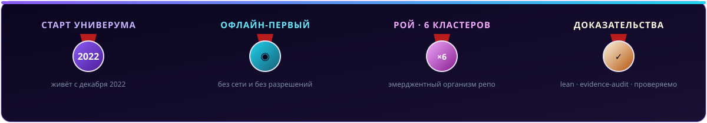

## ТЕРМИНАЛ РОЯ · живая neofetch-карта

  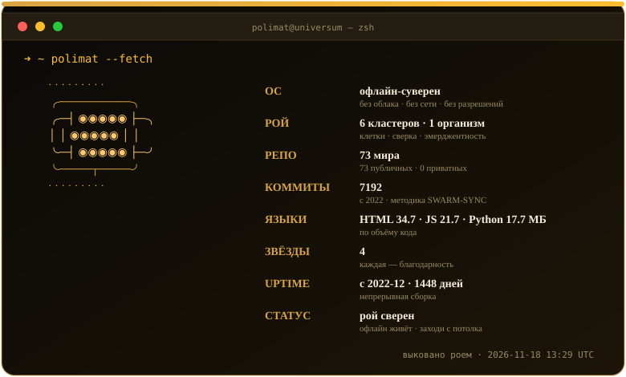

> Карта собирается собственным Action суточно по живому GitHub API — методика сверки та же, что у SWARM-SYNC, числа сходятся до единицы. Палитра — обсидиан и расплавленное золото ЖИВОЙ КУЗНИ.

## THE SWARM CRAWLS

<picture>
  <source media="(prefers-color-scheme: dark)" srcset="https://raw.githubusercontent.com/rtynbirf/rtynbirf/output/github-contribution-grid-snake-dark.svg">
  
</picture>

## СВЕТ ВСЕЛЕННОЙ · 3D

<picture>
  <source media="(prefers-color-scheme: dark)" srcset="https://raw.githubusercontent.com/rtynbirf/rtynbirf/main/profile-3d-contrib/profile-night-rainbow.svg">
  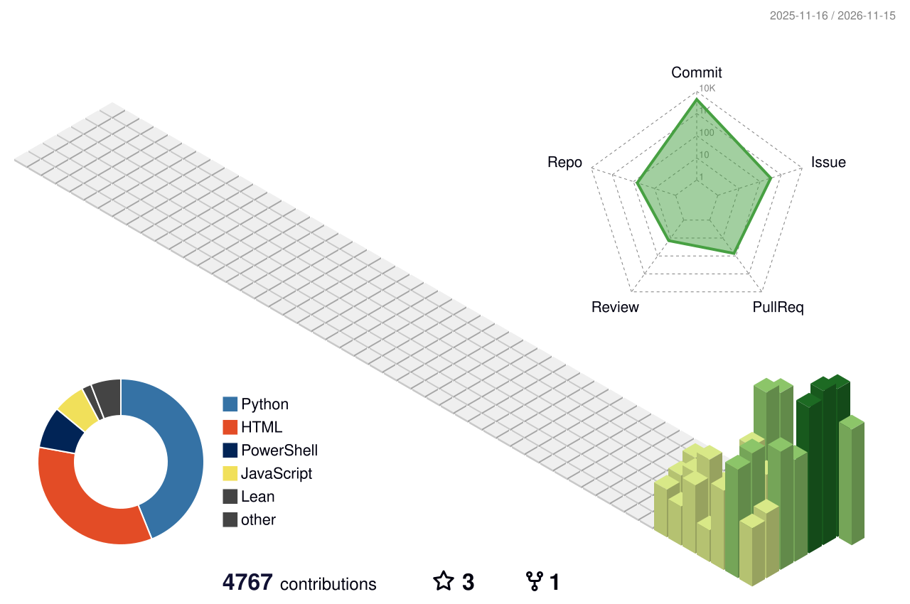
</picture>

---

  

<b><a href="https://rtynbirf.github.io">rtynbirf.github.io</a></b> — витрина вселенной · built by the swarm, for the swarm

<!--
ПОЛИМАТ: два слоя обложек — флагманы и штандарты фотов, серия ORNAMENTAL MYTHO-REALISM
(66 полотен по канону РЕВО: LAYOUT→RENDER→CRITIC, z-ai + PIL, 2026-11-10 · 2026-11-16: РЕВО-ПАСПОРТы на всех 68 страницах, автопилот v2, REVE=РЕВО).
Хедер профиля — написанная картина polimat-header.png (лапис · золото · феникс-медальон); серия переведена на канон ORNAMENTAL MYTHO-REALISM.
Обновляется автономно при крупных тактах.-->

## ⚖ РИТУАЛ ДОМА

Поработал → сделал → убрал за собой. Такт замкнулся — дом в покое: ни одного уведомления,
ни одного хвоста. Формализовано как конечный автомат и исполняется машиной —
[**domovoy-ritual**](https://github.com/rtynbirf/domovoy-ritual): устав `RITUAL-FSM.md`
(7 состояний, guard-ы, 12 дефолтов «всё решаю сам») + `house_fsm.py` (stdlib-only).

<!--ФОРЖ:КАНОН-СИНТЕЗ:НАЧАЛО-->
## 🧬 КАНОН × МИР · эмерджентный синтез (22.11.2026)

Дом прочитал мир и сверил законы (свежесть 22.11.2026): **agents.md** — открытый
стандарт инструкций агентам («over 60k open-source projects», под эгидой Linux
Foundation); **code.claude.com** — практики файлов памяти: «every line in it takes
a little of Claude's attention on *every* task», фильтр «Could it find this by
reading the code?», «the work is mostly removing lines»; исследование «Evaluating
AGENTS.md» (2026-02-12, по аннотации): раздутые context-файлы снижают успешность
агента и стоят +20% цены вывода.
Сходка подтвердила: append-only свидетель (нить Ариадны), fail-closed грамматики
(PeerManifest — четыре ключа), шрам-протокол, тесты канона — дом жил по этим
законам до того, как мир их сформулировал. Синтез — правила **29–37** закона дома:
РИТУАЛ ВХОДА · КАНОН = НЕПРОИЗВОДНОЕ · СВОД И ХВОСТ · ОБРАЗЕЦ СИЛЬНЕЕ КАПСА ·
ФОРМА, НЕ СПИСОК · ПРОГРЕССИВНОЕ РАСКРЫТИЕ · РЕЦЕДАЦИЯ ЯКОРЯ · ЧУЖОЙ ШРАМ — МОЙ
ФИКС · КАНОН-ПАТЧ. Свидетель захода — НИТЬ-АРИАДНЫ.jsonl (append-only хэш-цепочка);
патчи канона — диф-артефактами (правило 37).
<!--ФОРЖ:КАНОН-СИНТЕЗ:КОНЕЦ-->
<!--BEGIN_SWARM_SYNC-->
## 🛰 SWARM-SYNC · сверка со средой
> Автогенерация 2026-11-24 13:57 UTC · источник: живой GitHub API (public-флот: /users/rtynbirf/repos; языки — сумма байтов /repos/<repo>/languages, без истории git) · ни одного выдуманного числа · живой счёт роя для био — здесь, не в био

| Метрика | Значение |
|---|---|
| Репозиториев | **81** (81 публичных · 0 приватных) |
| Коммитов всего | **12353** |
| Последний push | 2026-11-24 |

**Языки по объёму кода:**
- `HTML` ██████████ 34.8 МБ
- `Python` ███████ 23.8 МБ
- `JavaScript` ██████ 21.7 МБ
- `Lean` ██ 6.9 МБ
- `PowerShell` █ 2.2 МБ

**Топ-5 репо по коммитам (видимая работа):**
- **rtynbirf** — 633 коммитов · Python
- **.github** — 502 коммитов · Python
- **markitdown** — 502 коммитов · Python
- **cell-swarm** — 488 коммитов · Python
- **H-PE11-PHOENIX** — 403 коммитов · PowerShell
<!--END_SWARM_SYNC-->

<!--ФОРЖ:ПОДВАЛ-->
---

  ◆ картина и штандарт — ручная ковка <a href="https://github.com/rtynbirf">КУЗНИ ПОЛИМАТ</a> · ЧЕЛОВЕК=АККАУНТ=PID1 ◆

<!--ФОРЖ:КАРТА-->
## КАРТА ДОМА

  

Все 81 комнат дома несут свою написанную картину-музу. Раунд 11: каждая муза переписана заново — 64 полотна в 64 собственных мастерских великих школ (швейцарская точность, Хокусай, Климт, Малевич, Лисицкий, Калдер, Пиранези, Клее, оп-арт и другие законы), двух похожих рядом нет. 22 живая светится, 42 под сводом архива одеты и заперты — красота без нарушения дислокации; на карте спящие звёзды носят золотые кольца. Угольная звезда rumu спит одетой — проснулась по слову Хозяина и легла обратно.

<!--ФОРЖ:АВТОМАТ:НАЧАЛО-->

**РЁВО-АВТОМАТ ЦЕНТРАЛЬНЫЙ v2** · конечный автомат над флотом · ORNAMENTAL MYTHO-REALISM · ИЗДАНИЕ r19c

> ОПИСЬ ДИНАМИЧЕСКАЯ: ФЛОТ 81 → ЗДРАВИЕ:80 · МУЗЕЙ:1 · зачислено сирот 0 · вылечено 0 · цикл: ПЕПЕЛ→ПРОБУЖДЕНИЕ→СВЕРКА→(зачисление/лечение)→ЗДРАВИЕ
> БАННЕР = ЛИЦО АККАУНТА: любое тело без лица зачисляется полным каноном автоматически. Доказательство работы: `automaton-state.json` и `fleet-desk.json`.

<!--ФОРЖ:АВТОМАТ:КОНЕЦ-->

<!--ФОРЖ:КАРТА:НАЧАЛО-->

### 🗺 ЖИВАЯ КАРТА РОЯ · переписывается автоматом при каждом обходе (данные API)

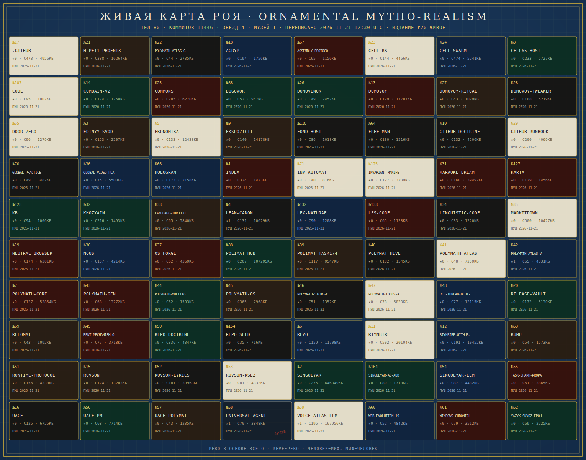

> Полотна лиц всех тел несут полосу ДАННЫХ API и перерисовываются, когда реальность ушла от запечатлённого (правило 25). Доказательства: `live-state.json`, `live-map.png`.

<!--ФОРЖ:КАРТА:КОНЕЦ-->
